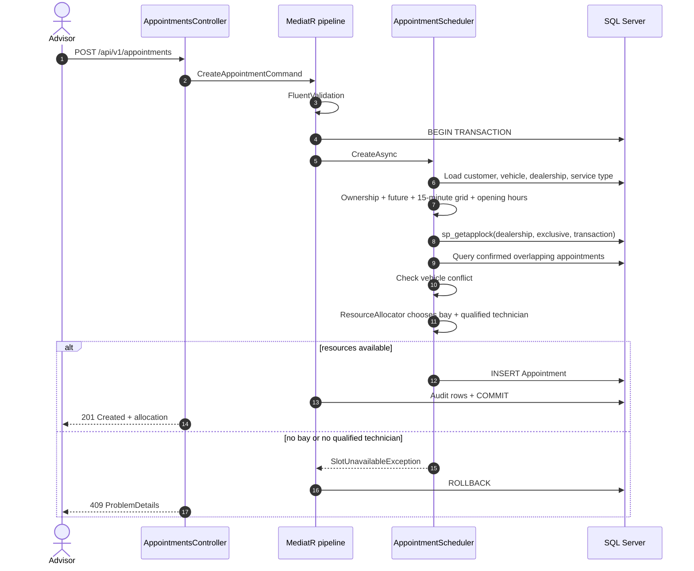

# Unified Service Scheduler — System Design

## 1. Context

**Scenario A** requires a service appointment to be booked against a customer, vehicle, dealership, service type and desired time only when the dealership can supply **both**:

- a free **service bay** for the entire service duration, and
- a free **technician qualified** for that service type for the entire duration.

The confirmed appointment must be persisted with every resource reference, and availability must be checked in real time.

This implementation is the backend. A client can be generated from [`openapi.json`](openapi.json) or driven with Swagger UI, [`Keyloop.API.http`](../Keyloop.API/Keyloop.API.http) and [`smoke-test.ps1`](../scripts/smoke-test.ps1). Swagger UI is served at `/swagger` in Development and uses the same JWT bearer scheme as the API.

## 2. Goals and non-goals

### Goals

- Correct, race-safe allocation of a bay and a qualified technician.
- Clear domain rules independent of EF Core and HTTP.
- Versioned REST API with predictable problem responses.
- Persistent SQL Server storage with migration and idempotent seed data.
- Tests for domain rules, scheduler edge cases, seeding and validation.
- Observable request flow and booking outcomes.

### Non-goals

- Customer-facing identity or per-customer authorization.
- Payments, invoicing, parts availability or notifications.
- Multi-day work orders, holiday calendars or variable daily hours.
- Rescheduling in place (cancel and rebook works today).
- A custom UI.

## 3. Architecture

```text
┌──────────────────────────────────────────────────────────────────┐
│ Keyloop.API                                                      │
│ Controllers · JWT bearer · ProblemDetails · health · OpenAPI     │
│ Serilog · OpenTelemetry                                          │
└───────────────────────────────┬──────────────────────────────────┘
                                │ MediatR
┌───────────────────────────────▼──────────────────────────────────┐
│ Keyloop.Application                                              │
│ Commands/queries · FluentValidation · transaction/audit behaviors│
│ Ports: IAppointmentScheduler, IUnitOfWork, ICurrentUser          │
└───────────────────────────────┬──────────────────────────────────┘
                                │ domain contracts
┌───────────────────────────────▼──────────────────────────────────┐
│ Keyloop.Domain                                                   │
│ Appointment · TimeInterval · Dealership opening hours            │
│ ResourceAllocator · domain exceptions                            │
└───────────────────────────────▲──────────────────────────────────┘
                                │ implemented by
┌───────────────────────────────┴──────────────────────────────────┐
│ Keyloop.Infrastructure                                           │
│ EF Core mappings · SQL Server · AppointmentScheduler · seeder    │
│ JWT/user services · audit interceptor · Dapper read executor      │
└──────────────────────────────────────────────────────────────────┘
```

Dependency direction is inward: Domain has no EF Core, ASP.NET Core or MediatR references. Application owns use cases and ports. Infrastructure implements ports. API composes the graph and exposes HTTP.

### Component responsibilities

| Component | Responsibility |
|---|---|
| `AppointmentsController` | HTTP contract, `201 Created`, dispatch commands/queries. |
| `DealershipsController` | Dealership list and availability search. |
| `CustomersController` | Customer list and vehicle lookup. |
| `ServiceTypesController` | Service catalogue. |
| `CreateAppointmentCommand` | Input contract and validation. |
| `TransactionBehavior` | Opens/commits/rolls back one transaction for transactional requests. |
| `ValidationBehavior` | Runs all FluentValidation validators before the handler. |
| `AuditBehavior` | Captures added/modified entities as audit rows inside the transaction. |
| `AppointmentScheduler` | Reference validation, time rules, locking, overlap query, allocation, DTO mapping, telemetry. |
| `ResourceAllocator` | Chooses the lowest-id free bay and the qualified technician with the fewest qualifications. |
| `DatabaseSeeder` | Idempotent demo data. |
| `GlobalExceptionHandler` | Maps domain/validation exceptions to RFC 7807 responses. |
| `SqlServerHealthCheck` | Readiness `SELECT 1`. |

## 4. Data model

### Entities

| Entity | Key fields | Notes |
|---|---|---|
| `Dealership` | `Id`, `Name`, `TimeZoneId`, `OpensAt`, `ClosesAt` | Opening hours are local to `TimeZoneId`. |
| `ServiceBay` | `Id`, `DealershipId`, `Name` | Unique name per dealership. |
| `ServiceType` | `Id`, `Name`, `DurationMinutes` | Positive duration; unique name. |
| `Technician` | `Id`, `DealershipId`, `Name` | Belongs to one dealership. |
| `TechnicianQualification` | `TechnicianId`, `ServiceTypeId` | Composite key; many-to-many qualification. |
| `Customer` | `Id`, `FullName` | Staff-facing record. |
| `Vehicle` | `Id`, `CustomerId`, `Vin`, `Make`, `Model` | Unique VIN. |
| `Appointment` | `Id`, `CustomerId`, `VehicleId`, `DealershipId`, `ServiceTypeId`, `TechnicianId`, `ServiceBayId`, `StartUtc`, `EndUtc`, `Status` | `Confirmed` or `Cancelled`; audit fields and row version. |
| `ApplicationUser` | `Id`, `Email`, `PasswordHash`, `Role` | Seeded demo advisor; admin comes from configuration. |
| `AuditLog` | `Id`, `EntityName`, `EntityId`, `Action`, JSON values, timestamp, actor | Added by the audit collector during transactional commands. |

### Relationships

```text
Customer 1 ───── n Vehicle
Dealership 1 ─── n ServiceBay
Dealership 1 ─── n Technician
Technician n ─── n ServiceType        (TechnicianQualification)

Appointment n ── 1 Customer
Appointment n ── 1 Vehicle
Appointment n ── 1 Dealership
Appointment n ── 1 ServiceType
Appointment n ── 1 Technician
Appointment n ── 1 ServiceBay
```

### Indexes and constraints

- `Vehicles.Vin` unique.
- `ServiceTypes.Name` unique.
- `ServiceBays (DealershipId, Name)` unique.
- `Appointments (DealershipId, StartUtc, EndUtc)` for conflict scans.
- `Appointments (TechnicianId, StartUtc, EndUtc)` and `(ServiceBayId, StartUtc, EndUtc)` for resource checks.
- `Appointments (VehicleId, Status, StartUtc, EndUtc)` for the vehicle double-booking guard.
- Check constraints: `EndUtc > StartUtc`, status in `('Confirmed','Cancelled')`, positive service duration, `ClosesAt > OpensAt`.

Foreign keys use `DeleteBehavior.Restrict` so history cannot be orphaned accidentally. The base model applies soft-delete query filters and a row-version concurrency token to auditable entities.

## 5. Booking flow



### Time rules

1. `startTime` is a `DateTimeOffset`; the scheduler converts it to UTC.
2. It must be strictly after `TimeProvider.GetUtcNow()`.
3. Converted to dealership-local time, the minute must be a multiple of **15** and seconds/milliseconds must be zero.
4. The full interval must satisfy `OpensAt <= start` and `end <= ClosesAt`, and must not cross local midnight.
5. The service duration comes from the catalogue, never from the client.

Using `TimeProvider` makes time-dependent tests deterministic.

### Allocation heuristic

`ResourceAllocator` receives the dealership's bays and technicians, the sets of busy resource IDs and the requested service type:

1. Pick the free bay with the lowest ID.
2. Pick a free technician qualified for the service type, ordered by **fewest qualifications**, then lowest ID.

Fewest-qualifications-first preserves specialists with broader skill sets for work only they can perform. The heuristic is deterministic, which makes tests and audits reproducible.

Failure codes:

| Code | Meaning |
|---|---|
| `NO_BAY_AVAILABLE` | Every bay is busy for the interval. |
| `NO_TECHNICIAN_AVAILABLE` | No free technician has the required qualification. |

## 6. Concurrency and consistency

### The race

Two requests can read "one bay free" simultaneously and both attempt to insert. Without coordination, both succeed and the dealership is over-booked.

### The strategy

1. The command runs inside one database transaction.
2. On SQL Server, the scheduler executes `sp_getapplock` with:
   - resource `appointment-scheduler:dealership:{dealershipId}`,
   - `@LockMode = 'Exclusive'`,
   - `@LockOwner = 'Transaction'`,
   - `@LockTimeout = 5000`.
3. Confirmed overlaps are queried **after** the lock is acquired.
4. Allocation and insertion happen before the lock-owning transaction commits.
5. A negative `sp_getapplock` result becomes a `409 Conflict`; the client can retry.

Different dealerships use different lock resources, so they book in parallel. The lock is skipped for EF InMemory, where tests are single-threaded.

### Why dealership-level?

- It is simple to reason about and needs no schema extension.
- It protects the whole allocation invariant, including the vehicle guard.
- Dealership booking throughput is low enough that serializing writes per dealership is acceptable.

At much higher throughput, the next step would be per-bay/per-technician exclusion or a queue that assigns resources in a single writer process. That is deliberately out of scope here.

### EF execution strategy

The unit of work and seeder open explicit transactions. EF Core's retrying execution strategy rejects user-initiated transactions unless the whole unit is wrapped in `CreateExecutionStrategy().ExecuteAsync(...)`. For this scope, retry-on-failure is disabled and the trade-off is documented; transient retries belong at the gateway until an execution-strategy wrapper is introduced.

## 7. Availability algorithm

`GET /api/v1/dealerships/{id}/availability?serviceTypeId={id}&date={date}`:

1. Load dealership, service type, bays and technicians (with qualifications).
2. If there are no bays or no qualified technician, return `[]`.
3. Convert local opening/closing to UTC for the requested date.
4. Load confirmed appointments that intersect the day.
5. Iterate local starts from opening time to `closing - duration`, in **30-minute** steps:
   - skip invalid DST times,
   - skip starts at or before `now`,
   - compute busy bay/technician sets for the interval,
   - run `ResourceAllocator`,
   - return the UTC interval when allocation succeeds.

Availability is advisory: it can change before the create request. The create path revalidates under the dealership lock. The response exposes UTC instants, not local strings, so clients can render them in any time zone.

## 8. API contract and errors

| Concern | Decision |
|---|---|
| Versioning | URL segment `v1` plus optional `X-Api-Version` header. |
| Auth | JWT bearer; scheduler endpoints require authentication. |
| Success body | Typed DTOs (`AppointmentDto`, `AvailableSlotDto`, reference DTOs). |
| Errors | `application/problem+json` with `status`, `title`, `detail`, `instance`, `traceId` and a stable `code`. |
| Not found | `404 not_found`. |
| Ownership | `403 forbidden`. |
| Allocation conflict | `409` with `NO_BAY_AVAILABLE`, `NO_TECHNICIAN_AVAILABLE`, `OUTSIDE_OPENING_HOURS`, `START_IN_PAST` or `INVALID_TIME_GRID`. |
| Same vehicle overlap | `409 conflict`. |
| Validation | `400 validation_failed` with an `errors` dictionary. |

`SlotUnavailableException` derives from `DomainException` but is mapped explicitly to `409` before the generic business-rule case.

## 9. Persistence and seeding

- EF Core 9 with SQL Server LocalDB for development; the connection string can be overridden with `ConnectionStrings__DefaultConnection` to use an instance such as `.\SQLEXPRESS`.
- One migration, `InitialCreate`, creates the scheduler tables, indexes and check constraints.
- `DatabaseInitializationHostedService` runs only when `Database:AutoMigrate`/`Database:Seed` are enabled (Development defaults).
- `DatabaseSeeder` returns early if dealerships exist, making startup repeatable.
- Seed data covers three time zones, multiple bays/technicians, overlapping qualifications and one demo appointment on the next working day.

Production would set both flags to `false` and run migrations as a deployment step.

## 10. Observability

### Logs

Serilog request logging wraps the exception handler, so handled 409s are logged with their real status rather than a temporary 500. The MediatR logging behavior logs expected domain rejections as warnings and unexpected failures as errors. Only IDs and codes are logged; customer names, VINs and emails are not written to application logs.

### Traces and metrics

`SchedulerDiagnostics` owns an `ActivitySource` and `Meter` named `Keyloop.Scheduler`:

| Signal | Type | Tags |
|---|---|---|
| `scheduler.create_appointment` | activity | `dealership.id`, `service_type.id`, `appointment.id` |
| `scheduler.bookings.created` | counter | `dealership.id` |
| `scheduler.bookings.rejected` | counter | `reason` |
| `scheduler.booking.duration` | histogram (ms) | `dealership.id` |

ASP.NET Core and HTTP client instrumentation are registered. A console exporter can be enabled with `Observability:ConsoleExporter=true` (opt-in to avoid noisy logs).

### Health

- `/health/live` — process is running.
- `/health/ready` — SQL Server responds to `SELECT 1`.
- `/health` — alias of readiness.

## 11. Security

- JWT validation checks issuer, audience, signing key and lifetime with a one-minute clock skew.
- The development signing key and admin credentials are configuration values and must be replaced outside local demos.
- Password hashes use PBKDF2-SHA512 with 210,000 iterations and fixed-time comparison.
- The scenario is staff-facing; there is no customer-scoped authorization. Adding roles such as `Advisor`/`DealershipAdmin` would be the next security step.
- EF parameterization and DTO projection avoid SQL injection and over-posting.

## 12. Testing strategy

| Layer | Approach |
|---|---|
| Domain | Pure unit tests for intervals, opening hours, allocation and cancellation. |
| Scheduler | EF InMemory with a fixed `TimeProvider`; covers success, distinct-resource allocation, saturation, ownership, double booking, time rules, availability filtering and cancellation idempotency. |
| Seeder | InMemory; verifies counts, idempotency and future working-day placement. |
| Validators | FluentValidation rules for commands/queries. |
| HTTP | PowerShell smoke test against the real API and LocalDB: login, reference data, availability, create, read, cancel, 401/403/404/409/400 responses and resource saturation. |

41 automated tests pass. The smoke transcript is in [`DEMO.md`](DEMO.md).

## 13. Trade-offs and future work

| Trade-off | Current choice | Scale-up path |
|---|---|---|
| Lock granularity | Dealership-level `sp_getapplock` | Per-resource locks or a single-writer booking queue |
| Retry strategy | Disabled to keep explicit transactions valid | Execution-strategy wrapper around each command |
| Time zones | Windows IDs, host-dependent | IANA IDs with a converter, store as `varchar(64)` |
| Availability | On-demand scan of the day | Materialized resource calendars or a scheduling service |
| Seed idempotency | Skip if dealerships exist | Per-aggregate upserts keyed by natural keys |
| Authorization | Any authenticated user | OIDC, dealership roles, customer scoping |
| Read scale | EF projections on the primary | Read replica + Dapper read models |
| API surface | Create/get/cancel + reference data | Reschedule, list/search with pagination, idempotency keys |
| Client | OpenAPI/.http/script | Generated typed client or advisor UI |

Natural next features: rescheduling, a paged appointment list, holiday calendars, customer notifications, parts availability and a CI pipeline with disposable SQL Server integration tests.

## 14. AI collaboration

AI was used as a pair-programming aid for:

- mapping the assessment scenario onto the existing Clean Architecture solution,
- generating repetitive EF configurations, DTOs, tests and documentation drafts,
- reviewing concurrency ordering and the transaction/audit pipeline,
- proposing edge cases for availability and resource saturation.

All generated code was compiled, tested and exercised against LocalDB. Review caught three runtime issues that were fixed before delivery:

1. EF Core retrying execution strategy conflicted with explicit transactions.
2. The DbContext factory registered a second, differently configured context.
3. Serilog request logging was outside the exception handler, producing misleading 500 logs for handled 409s.

The architectural choices, business rules, seed credentials, scope decisions and final verification remain the author's.
